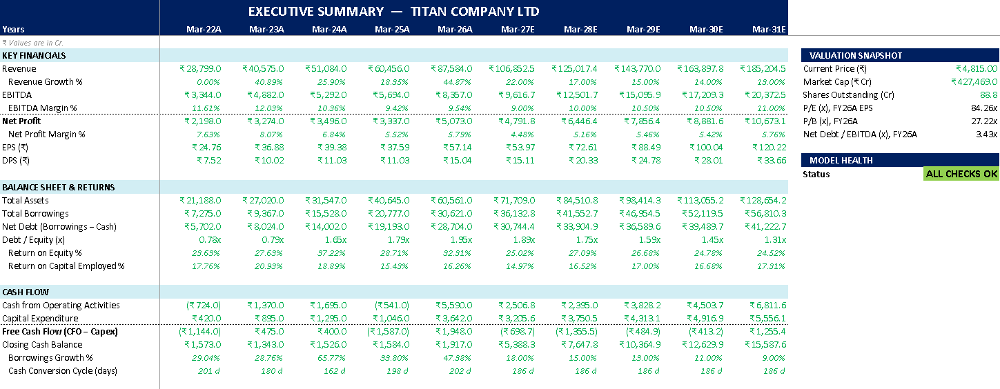
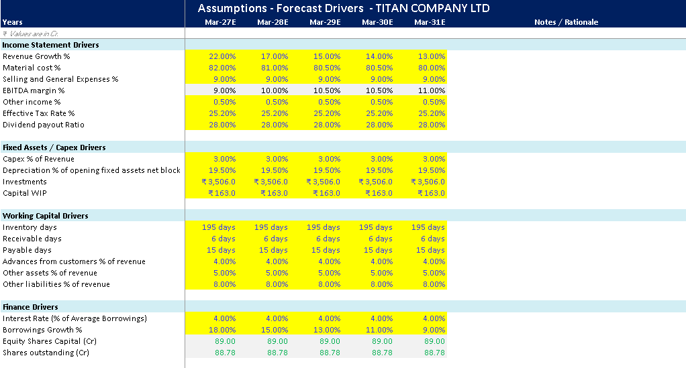
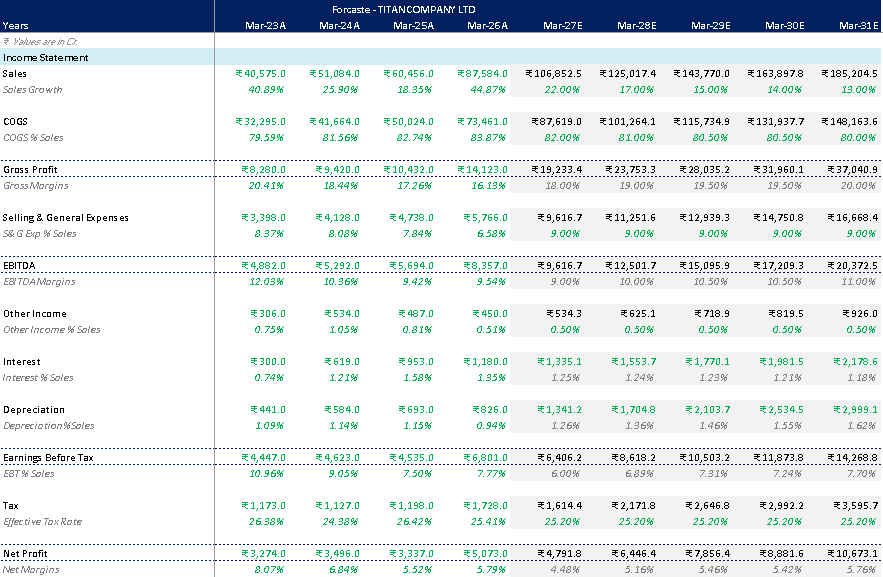
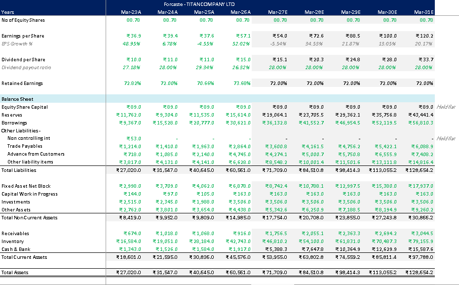
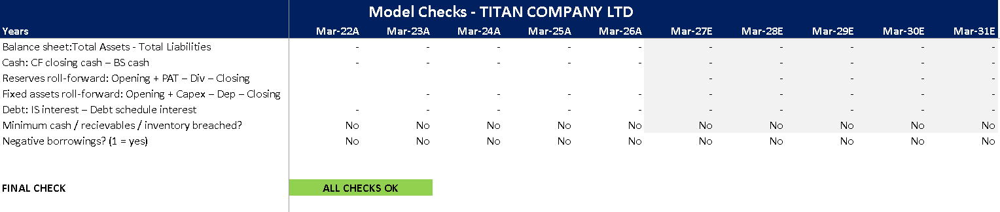

# Titan Company Ltd: Integrated 3-Statement Financial Model

An Excel model that links the **income statement, balance sheet and cash flow statement** of Titan Company Ltd (NSE: TITAN) and forecasts them for five years (FY27E to FY31E), driven by a single assumptions sheet.

> **Units:** ₹ crore | **Basis:** Consolidated | **Year end:** 31 March | **Actuals:** FY17 to FY26 | **Forecast:** FY27E to FY31E
> **Data source:** [Screener.in](https://www.screener.in/company/TITAN/consolidated/) consolidated financials, pulled 25 Sep 2026

---

## Why Titan?

Titan is a retail and manufacturing business (Tanishq, Mia, CaratLane, watches and wearables, eyecare, fragrances) where the story is *revenue, then margins, then working capital (mostly gold inventory), then cash*. It is not a bank, NBFC or insurer, so a standard three-statement structure fits well.

## What the model does

- Rebuilds ten years of historical statements from Screener data and links them to the raw data sheets.
- Forecasts all three statements for FY27E to FY31E from one **Assumptions** sheet.
- Supports the forecast with separate schedules: **fixed assets**, **working capital** and **debt and interest**.
- Calculates growth, margin, return and leverage **ratios**.
- Runs automatic **integrity checks** so the balance sheet and cash flow tie out every year.

## Model structure

| Sheet | Purpose |
|---|---|
| Cover | Overview, colour legend, sheet map, key simplifications |
| Summary | One-page output: key financials, returns, cash flow, valuation snapshot |
| Assumptions | All forecast drivers in one place (change these to run scenarios) |
| Historical FS | Ten years of income statement, balance sheet and cash flow, linked to raw data |
| Forcasting | Integrated income statement, balance sheet and cash flow (historical plus forecast) |
| FA Schedule | Fixed asset and depreciation roll-forward, CWIP, investments |
| WC Schedule | Inventory, receivables, payables, advances and other working capital items |
| Debt Schedule | Borrowings and interest |
| Ratio Analysis | Growth, EBITDA and net margin, ROE, ROCE, debt/equity and more |
| Checks | Balance sheet, cash tie-out and roll-forward checks |
| Data Sheet / Cashflow Data / Other liabilities Data | Raw Screener inputs |

**Colour code:** blue = hard-coded input, black = formula, green = link from another sheet, yellow fill = key forecast driver, grey fill = forecast columns.

## Key forecast assumptions

| Driver | FY27E | FY28E | FY29E | FY30E | FY31E |
|---|---|---|---|---|---|
| Revenue growth | 22% | 17% | 15% | 14% | 13% |
| EBITDA margin | 9.0% | 10.0% | 10.5% | 10.5% | 11.0% |
| Borrowings growth | 18% | 15% | 13% | 11% | 9% |

Held constant across the forecast: tax rate 25.2%, dividend payout 28%, capex 3% of revenue, depreciation 19.5% of opening net block, inventory 195 days, receivables 6 days, payables 15 days, customer advances 4% of revenue, interest 4% of average borrowings.

## Headline outputs

| ₹ crore | FY26A | FY31E |
|---|---|---|
| Revenue | 87,584 | 185,205 |
| EBITDA | 8,357 | 20,372 |
| Net profit | 5,073 | 10,673 |
| EPS (₹) | 57.1 | 120.2 |
| Debt / equity (x) | 1.95 | 1.31 |
| Return on equity | 32.3% | 24.5% |

## Model integrity

The **Checks** sheet tests, for every year:

- Total assets minus total liabilities and equity = 0
- Closing cash on the cash flow statement = closing cash on the balance sheet
- Reserves, fixed asset and debt roll-forwards reconcile
- No negative borrowings and no minimum cash, receivable or inventory breaches

Status in the final file: **ALL CHECKS OK**.

## Screenshots

**Executive summary**

**Forecast assumptions**

**Forecast income statement**

**Forecast balance sheet**

**Model checks**

## Key simplifications and limitations

- Screener provides cost lines as rounded percentages of sales, so material and employee costs are rebuilt from those percentages and "Other expenses" is the balancing figure.
- Historical cash flow is shown as reported. Screener's balance sheet cash uses a narrower definition, so historical net cash flow does not tie to the change in balance sheet cash; the **forecast ties exactly**.
- Dividends are assumed to be paid in the same year as the profit (Titan actually pays the final dividend the following year).
- Lease liabilities, CWIP, investments and share capital are held flat.
- Borrowings follow a growth assumption rather than a cash-sweep or revolver, so cash builds up in the forecast while debt also rises.
- Minority interest is not modelled separately.
- Forecast assumptions are illustrative.

## How to use

1. Download `Titan_3_Statement_Model.xlsx`.
2. Open the **Cover** sheet for the legend and sheet map.
3. Change the yellow driver cells on **Assumptions**.
4. Check the **Summary** and **Checks** sheets update.

## Related project

[Titan Company DCF Valuation Model](https://github.com/ACCA-Sachin/titan-dcf-valuation): FCFF-based valuation of the same company.

## Disclaimer

This project is for educational and portfolio purposes only. It is not investment advice.

## Author

**Sachin** | [LinkedIn](https://www.linkedin.com/in/sachin-dangwal) | [GitHub](https://github.com/ACCA-Sachin)
